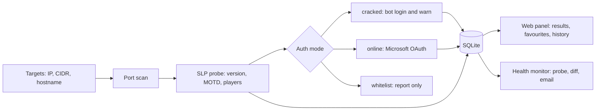

<div align="center">

```text
  ◆──────────────────────────────────────◆
  ███╗   ███╗ ██████╗    ███████╗ ██████╗
  ████╗ ████║██╔════╝    ██╔════╝██╔════╝
  ██╔████╔██║██║         ███████╗██║
  ██║╚██╔╝██║██║         ╚════██║██║
  ██║ ╚═╝ ██║╚██████╗    ███████║╚██████╗
  ╚═╝     ╚═╝ ╚═════╝    ╚══════╝ ╚═════╝
  ◆──────────────────────────────────────◆
```

# MC Scanner v3.6.5

### Is your Minecraft server in offline mode? Which ports are public? Is RCON exposed?

Pure Python. No Java, no game client, no bundled binaries. One command to check, one panel to manage.

[](https://github.com/IRmsk/mc-scanner-v3/actions)
[](https://www.python.org/)
[](#capability-matrix)
[](LICENSE)

[](CHANGELOG.md)
[](#requirements)

[30-second check](#30-second-self-check) · [CLI](#cli-reference) · [Capabilities](#capability-matrix) · [Safety](#safety-switches) · [中文文档](README.zh-CN.md)

</div>

---

## 30-second self-check

```bash
pip install -r requirements.txt
python3 cli.py scan play.example.com:25565
```

Real output, unedited, from a local test server:

```text
[*] found 1 Minecraft server:
  127.0.0.1:25599 | 1.21.1 (proto 767) | 5/100 players | cracked | vanilla
                                                            ^^^^^^^
```

`cracked` means **offline mode**: anyone can join with any username, including as an operator.

| Value in column 4 | Meaning | What to do |
|---|---|---|
| `online` | Mojang authentication enforced | Nothing wrong |
| `cracked` | **Offline mode — anyone can join, anyone can become OP** | Set `online-mode=true` in `server.properties` |
| `whitelist` | Whitelist on, outsiders rejected | Fine — this is the good value |
| `rejected` | Connection refused | Check the server log |

### Two more things worth confirming

| Question | Command | Reading the result |
|---|---|---|
| Which ports besides 25565 are public? | `python3 cli.py portscan <your public IP> --port 1-65535` | Every row is an internet-reachable port |
| Is RCON exposed? | `python3 cli.py portscan <your public IP> --port 25575` | Any result means the console is reachable — change `rcon.password` or close it |

> All three commands touch only the address you pass in. **Point them at a server you are responsible for.** This is a self-check tool, not a find-someone-else's-server tool.

---

## What it does

MC Scanner answers four questions about a server, in order:

1. **Is anything listening?** Port scan over an IP, a CIDR range or a hostname — with `masscan` when a range is too large for pure-Python sockets.
2. **What is it?** SLP probe returns version, protocol number, MOTD, player count and the sample player list; fingerprinting separates vanilla / Paper / Spigot / Forge / Fabric / NeoForge.
3. **Who can get in?** Auth probing classifies the server as `online`, `cracked`, `whitelist` or `rejected`.
4. **Then what?** Log in as a bot and post a warning, attach an observer to follow chat live, or let the health monitor watch favourites and email you when players come and go.



The default posture is **check yourself**: one address you are responsible for, see what it exposes. Range scanning, observers and login warnings exist too — those are the "authorisation already granted" mode, see [Capability matrix](#capability-matrix).

---

## Features

### 🔍 Scan and probe

| Capability | Detail |
|---|---|
| Port scanning | Multi-threaded sync engine plus an asyncio pipeline; CIDR, port ranges, hostnames |
| SLP probe | Version, protocol number, MOTD, player count, sample players, favicon hash |
| Auth detection | `online` / `cracked` / `whitelist` / `rejected`, keyword table shared between probe and bot |
| Fingerprinting | vanilla · Paper · Spigot · Forge · Fabric · NeoForge, plugin channels inspected |
| Two-stage discovery | `masscan` finds ports across huge ranges, SLP probing follows only the hits |
| Resume | `--resume` continues an interrupted scan; the progress file is version-checked, corrupted files are rejected |

### 🤖 Bot and observer

| Capability | Detail |
|---|---|
| Login and message | Join a server as a bot, post one or more messages, hold the session for N seconds |
| AuthMe | `auto` / `login_only` / `register_then_login`, branching on the server's actual reply |
| Multi-version | 40 protocol versions generated from `minecraft-data`, plus a hand-written fallback |
| Concurrency | Per-server cap via `bot_threads`; scans, bots, observer and health monitor run in parallel |
| Observer | Live chat, joins and leaves, per-date log grouping, IP search, TXT/HTML export, backoff reconnect |
| Premium login | Microsoft OAuth device code, multi-account storage, RSA-2048+SHA256 chat signing |

### 🧠 AI hosting (experimental, off by default)

| Capability | Detail |
|---|---|
| Chat bots | OpenAI-compatible endpoints: DeepSeek, OpenAI, local Ollama |
| Personas | 12 assistant-themed presets, editable in the panel; text in `docs/AI_PERSONAS_DETAILED.md` |
| Layered memory | Short-term raw log, mid-term summary, long-term per-player profile, clearable |
| Guardrail | Every outbound line passes `core/ai_bot.py::_safe_send_chat`: control characters stripped, `/` commands blocked, 200-char cap, newlines blocked, 0.8s per-bot rate limit |

> The guardrail is **command and format filtering, not content moderation**. Personas may only be used on servers you own or are explicitly authorised to test.

### 🛡️ Scan modes

| Mode | Concurrency | Rate | Intended use |
|---|---|---|---|
| `safe` | Low | Adaptive throttle | Public internet and authorised testing |
| `balanced` | Medium | Moderate | Default for routine scans |
| `aggressive` | High | Full speed | Internal or trusted networks only |

Adaptive rate limiting backs off when timeouts spike and aborts on connection anomalies. Batches cool down between rounds; up to `max_concurrent_scans` tasks run at once while bots, observers, AI and monitoring keep going.

### 🌐 Web panel

- Starts on `http://127.0.0.1:8080`, dark theme, responsive down to phone width
- **Login required**: first launch is `admin` / `admin123` and you must change credentials before doing anything; sessions last 7 days in browser `localStorage`
- **Page shell is unauthenticated, every data endpoint is not**: `/api/*` wants `X-API-Token` — either the session token or the `web_token` from config. Scripts can send `-H "X-API-Token: <token>"` or `?token=`
- Before binding `0.0.0.0`, set `web_token` or change the default password or anyone on the subnet can log in
- Scans, results, favourites, observers, AI bots, premium accounts, database, player history in one place
- Capability badges always visible; read-only switch and audit log for every write

### 💓 Health monitor

- Probes favourites on a schedule, records online/offline, player count and joins/leaves; changes can be mailed as a digest
- Gentle by default to avoid rate limits and bans: 8 parallel probes, 1.5s minimum gap per IP, 300s between rounds — all adjustable
- Fast mode tries version detection only, no full protocol walk: 55 targets in about ten seconds; missing auth data is filled in automatically
- Optionally includes popular servers found in the database (up to 20); set `health_monitor_db_extra: false` to watch favourites only

---

## CLI reference

`python3 cli.py <command> --help` prints the full option list for any of these.

| Command | What it does |
|---|---|
| `portscan` | Ports only, no Minecraft protocol |
| `scan` | Port scan + SLP probe + auth detection — the main path |
| `masscan` | Large-range discovery through `masscan` |
| `import` | Load `masscan` output into the database |
| `query` | Search and filter the database, print statistics |
| `bot` | Log into one server and send messages |
| `web` | Start the Web panel |
| `random` | Sample random IPs and ports (needs `capabilities.public_scan`) |
| `fav` | Favourite management: `list` / `add` / `remove` / `rescan` / `tags` |
| `rescan` | Smart re-scan queue: `--list` / `--run` / `--clear` / `--remove` |
| `distributed` | Experimental shard jobs: `--create` / `--status` / `--worker` |
| `proxy` | Proxy pool: `--add` / `--fetch` / `--check` / `--file` |
| `rcon` | RCON console (needs `capabilities.rcon_commands`) |
| `commands` | Run a command list right after login (same gate) |

```bash
# scan: modes, ports, resume, worker pool, exclusions
python3 cli.py scan 10.0.0.0/24 --port 25565 --mode safe --workers 24 --rate 30 --exclude exclude.conf

# masscan: requires an explicit authorisation flag, probes afterwards
python3 cli.py masscan --targets 10.0.0.0/16 --port 25565 --rate 1000 --exclude exclude.conf \
  --i-have-authorization --auto-import

# bot: messages, hold time, AuthMe, protocol override
python3 cli.py bot 192.168.1.10:25565 -u SecurityBot \
  -m "This server runs offline mode; consider online-mode=true" --hold 10 --authme hunter2

# Web panel on another port
python3 cli.py web --port 8080 --host 127.0.0.1
```

| Exit code | Meaning |
|:--:|---|
| 0 | Success |
| 1 | No results, or the run failed |
| 2 | High-speed mode not confirmed |
| 3 | Parameter error (missing arguments or missing `--yes`) |
| 4 | Blocked by a capability switch |

---

## Quick start

### Requirements

| Item | Requirement |
|---|---|
| Python | 3.10+ (3.12 recommended) |
| OS | Linux · macOS · Windows · Termux (Android) |
| Optional | `masscan` on `PATH` for large-range discovery |
| Network | Outbound HTTPS for the protocol table and, for premium login, Microsoft |

```bash
git clone https://github.com/IRmsk/mc-scanner-v3.git
cd mc-scanner-v3
pip install -r requirements.txt
cp config.example.json config.json       # optional
python3 cli.py --help                    # sanity check
```

> `flask` is needed for the panel, `pycryptodome` for premium login. `uvloop` and `pysimdjson` are optional and fall back silently. Nothing is vendored — the old `libs/` directory is gone.
>
> Windows: double-click `run.bat`. Termux: `pkg install python openssl`, then `pip install flask pycryptodome`.

### First scan

1. Pick an address you are responsible for, or `mc.example.com`
2. Port defaults to `25565`, accepts ranges like `25565-25570`
3. Choose `safe` for public networks, `balanced` for routine work
4. Read column 4 — that is the verdict

Two stages run under the hood: ports first, then SLP probe plus auth detection. Results land in the panel with filters for auth mode, version and keyword.

### Premium account (Microsoft)

1. Panel → Settings → Premium accounts → "Get device code"
2. Open `microsoft.com/link`, enter the code, sign in
3. The account is stored locally; tick "premium verification" when using observer or AI

Chat signing uses RSA-2048 + SHA256 with the certificate Mojang issues, and falls back to unsigned if signing fails.

---

## Configuration

`config.json` is generated on first run. Defaults below come from `config.py::DEFAULT_CONFIG`:

| Key | Default | Meaning |
|---|---|---|
| `username` | `SecurityBot` | Default bot name |
| `messages` | `null` | Messages to send; built-in warning text when empty |
| `ports` | `[25565]` | Default ports |
| `scan_threads` | `50` | Port-scan threads |
| `scan_timeout` | `3.0` | Per-target connect timeout |
| `workers` | `16` | SLP probe workers |
| `timeout` | `5.0` | SLP probe timeout |
| `bot_threads` | `5` | Concurrent bot sessions |
| `bot_timeout` | `15` | Bot socket timeout |
| `message_delay` | `1.2` | Gap between messages |
| `rate` | `30` | Global requests per second |
| `retry_count` | `1` | Retries per target |
| `exclude_file` | `exclude.conf` | Exclusion list |
| `db_path` | `mcscanner.db` | SQLite database |
| `output_format` | `json` | `json` / `csv` / `txt` |
| `web_host` / `web_port` | `127.0.0.1` / `8080` | Panel bind address |
| `web_token` | `""` | Fixed API token for scripts; empty means session login only |
| `log_level` | `INFO` | Log verbosity |
| `api_rate_limit` | `600` | Web API requests per window |
| `health_interval` | `300` | Health monitor round interval |
| `health_probe_concurrency` | `8` | Parallel health probes |
| `health_probe_ip_gap` | `1.5` | Minimum gap per IP, seconds |
| `health_monitor_db_extra` | `false` | Also monitor popular servers from the database |

Sensitive values can come from the environment instead:

```bash
MC_WEB_TOKEN=...            # fixed API token
MC_AI_API_KEY=...
MC_AI_BASE_URL=https://api.deepseek.com
MC_AI_MODEL=deepseek-chat
MC_AUTHME_PASSWORD=...
MC_DISCORD_WEBHOOK=...
```

### Safety switches

These keep the tool inside its stated scope. Defaults are what `cli.py` and `web/` actually resolve to when a key is absent.

| Switch | Default | Effect |
|---|---|---|
| `ALLOW_PUBLIC_BIND` (env) | unset | Binding to `0.0.0.0` refuses to start unless this is `1` |
| `capabilities.scan` | `true` | Basic scanning |
| `capabilities.public_scan` | `false` | Random internet-wide scanning, `random` and `distributed` |
| `capabilities.rcon_commands` | `false` | RCON console and post-login command lists |
| `health_monitor_db_extra` | `false` | Probing third-party servers scraped from the database |
| panel login | `admin` / `admin123` | Forced credential change on first login |

---

## Capability matrix

Deliberately honest — what works, what half-works, what is out of scope:

| Scenario | Status | Notes |
|---|:--:|---|
| Port scan and SLP probe | ✅ Reliable | Main path, covers every supported version |
| Offline server login and messaging | ✅ Reliable | The main security-warning use case |
| Premium server login | ✅ Works | Microsoft OAuth first |
| Premium server chat | ✅ Works | Mojang-issued RSA certificate, RSA-2048+SHA256 signing, unsigned fallback |
| Forge / Fabric / NeoForge servers | ⚠️ Partial | Passes acceptance as a vanilla client; forced mod validation rejects the login |
| 1.12.2 and older | ⚠️ Best effort | Covered and tested, edge cases remain |
| Full Minecraft client | ❌ Not a goal | No rendering, no world, no mod loading |
| Unauthorised internet-wide scanning | 🚫 Forbidden | See [Legal & ethics](#legal--ethics) |

Open issues are listed in [CHANGELOG.md](CHANGELOG.md) under each release's "Still broken" notes.

---

## Troubleshooting

<details>
<summary><b>ModuleNotFoundError: No module named 'flask'</b></summary>

Dependencies are not installed. Run `pip install -r requirements.txt`.
</details>

<details>
<summary><b>Premium login fails with <code>authservers_down</code></b></summary>

Mojang authentication is temporarily unavailable. Wait a few minutes and confirm your network reaches `authserver.mojang.com`.
</details>

<details>
<summary><b>Kicked with <code>chat.disabled.missingProfileKey</code></b></summary>

The server enforces secure profiles. An offline account cannot chat there — use a premium account.
</details>

<details>
<summary><b>Kicked with <code>Packet chat was larger than expected</code></b></summary>

A chat packet layout difference on some offline servers, still under investigation. Payload hex logging is in place; try another server meanwhile.
</details>

<details>
<summary><b>Cannot join a NeoForge or Forge server</b></summary>

Forced mod validation requires the client to present a mod list. Servers configured to allow vanilla clients work.
</details>

<details>
<summary><b>Progress bar jumps straight to 100%</b></summary>

Small targets finish before the bar can animate. Raise `--workers` for large ranges.
</details>

<details>
<summary><b><code>pip install</code> fails to compile on Termux</b></summary>

Install the system packages first (`pkg install python openssl`), then only pure-Python packages: `pip install flask pycryptodome`.
</details>

<details>
<summary><b>Uninstall</b></summary>

```bash
# stop the panel first, then remove the directory
rm -rf mc-scanner-v3        # database and config live inside, they go with it
```
</details>

---

## Project structure

```text
mc-scanner-v3/
├── cli.py                  # 14 subcommands, the only entry point
├── config.py               # DEFAULT_CONFIG, env overrides, atomic writes
├── core/
│   ├── bot.py              # Bot session: join, chat, AuthMe, reconnect
│   ├── conn.py             # Connection and encryption layer
│   ├── probe.py            # SLP and auth probing
│   ├── protocol.py         # Version mapping and protocol constants
│   ├── packets.py          # Table loading and integrity check
│   ├── packets_auto.json   # Generated table, 40 protocol versions
│   ├── microsoft_auth.py   # Device-code OAuth
│   ├── ed25519.py          # Pure-Python signing, zero dependencies
│   ├── rcon.py             # RCON client
│   ├── ai_bot.py           # AI session and the single outbound filter
│   ├── ai_memory.py        # Layered memory
│   └── protocols/          # Per-version handlers
├── scanner/                # Port scan, async pipeline, progress storage
├── web/
│   ├── app.py              # Flask app, token auth
│   ├── index.html          # Panel front end
│   └── routes_*.py         # One module per API area
├── service/                # Scan and warn task services
├── storage/                # Favourites persistence
├── notify/                 # Email and webhook delivery
├── tools/                  # gen_packets.py, get_mc_token.py, send_command.py
├── distributed/            # Experimental sharding
├── android_patches/        # Experimental Kivy/Android patch
├── tests/                  # unit and integration suite
├── docs/AI_PERSONAS_DETAILED.md
├── config.example.json     # Template kept in sync with DEFAULT_CONFIG
├── requirements.txt
├── run.bat / run.sh        # Launchers; version read from config.__version__
└── LICENSE                 # GPL-3.0
```

---

## Tests

```bash
python3 -m pytest tests/ -q
```

Coverage spans protocol-table integrity, version mapping, auth probing, Login Start and Client Settings segmentation, AuthMe branching, progress storage, AI guardrails, capability gates, atomic writes and failure paths. CI runs the same suite and a `ruff` gate on every push.

Regenerate the protocol table with:

```bash
python3 tools/gen_packets.py --download
```

---

## Changelog

**v3.6.5** is a security maintenance release: the decompression-bomb cap is actually enforced with `decompressobj(max_length)`, VarInt is limited to five bytes with proper sign extension, NBT list counts are validated against the remaining stream, two stored XSS were rebuilt on `escapeHtml`, AI endpoints stopped accepting a per-request `base_url`, favourites and config writes moved to `mkstemp` + `os.replace`, and safe mode no longer runs at twenty times its designed concurrency.

Full history from v3.4.0 through v3.6.5, including every "Still broken" list, is in **[CHANGELOG.md](CHANGELOG.md)**.

---

## Legal & ethics

> This section is a hard constraint, not a suggestion.

**Permitted:** security research on systems you have explicit authorization for; your own servers; isolated lab networks.

**Prohibited:** scanning, probing or logging into servers you do not own and are not authorised to test; running `/op`, `/gamemode`, `/ban`, `/stop` or any command on third-party servers; attaching RCON to unauthorised servers; DDoS, botnets or spam; collecting or publishing other people's player data, IPs or personal information; bypassing whitelists, premium verification or any other access control.

**Privacy:** scan data stays local in SQLite; nothing is uploaded to a third party; `.gitignore` excludes `*.db`, `config.json` and generated output.

<details>
<summary><b>Legal references (China mainland and elsewhere)</b></summary>

Unauthorised scanning, login or control of computer information systems may engage Criminal Law of the PRC Article 285 (illegal intrusion, and providing intrusion tools), Article 286 (destroying computer information systems) and Article 287(2) (assisting information-network criminal activity), alongside the Cybersecurity Law, Data Security Law and Personal Information Protection Law. Outside mainland China the equivalent statutes apply — CFAA, GDPR and local computer-misuse law.

</details>

<details>
<summary><b>Disclaimer</b></summary>

Provided "as is", with no warranty of fitness, reliability or safety. You bear all legal responsibility for how you use it. The author accepts no liability for direct or indirect damages. If you disagree with these terms, stop using the tool and delete it. Nothing here is legal advice.

</details>

---

## License

[GNU GPL v3.0](LICENSE). Use, modification and distribution must remain open source under the same licence.

Not affiliated with Mojang, Microsoft or any server operator.

<div align="center">

**Stay inside your authorisation. Scan safely. 🟢**

</div>
